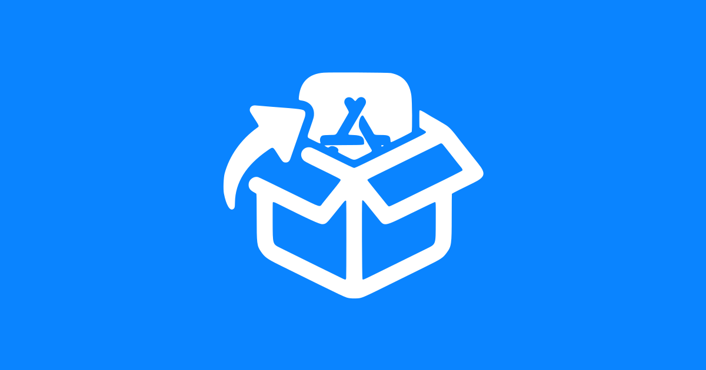

<p align="center">
  
</p>

<h1 align="center">iOS Sideload Source</h1>

<p align="center">
  <a href="https://aiko3993.github.io/iOS-Sideload-Source/">
    
  </a>
</p>

<p align="center">
  A personal, self-updating sideload source for AltStore / SideStore / LiveContainer etc. <br>
  If you know of any interesting apps worth sideloading, feel free to suggest them in the Issues.
</p>

---

## Sources

### Standard

* **Original**
```text
https://Aiko3993.github.io/iOS-Sideload-Source/sources/standard/original/source.json
```

* **Coexist**
```text
https://Aiko3993.github.io/iOS-Sideload-Source/sources/standard/coexist/source.json
```

<details>
<summary><b>NSFW (Click to expand)</b></summary>
<br>

* **Original**
```text
https://Aiko3993.github.io/iOS-Sideload-Source/sources/nsfw/original/source.json
```

* **Coexist**
```text
https://Aiko3993.github.io/iOS-Sideload-Source/sources/nsfw/coexist/source.json
```
</details>

---

## Disclaimer

This repository serves as a mirror and index. App copyrights belong to their respective authors. Assess risks before sideloading.
